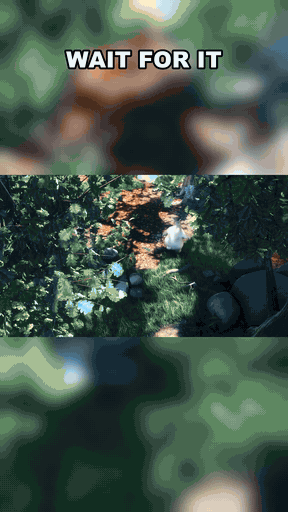
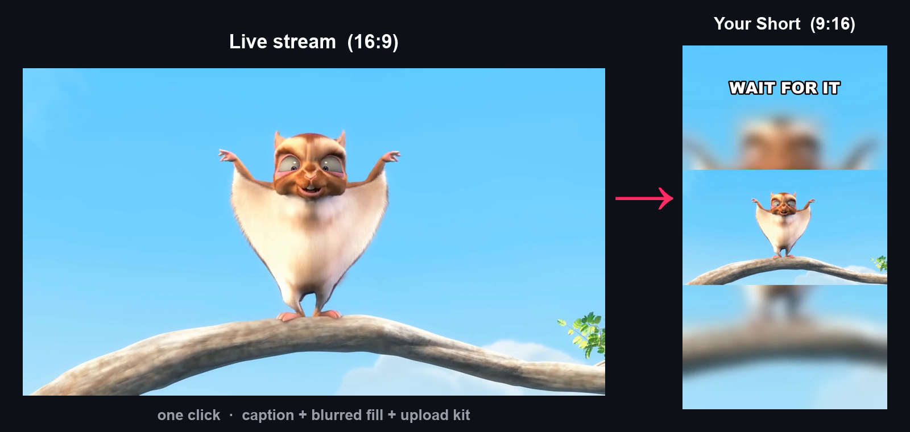
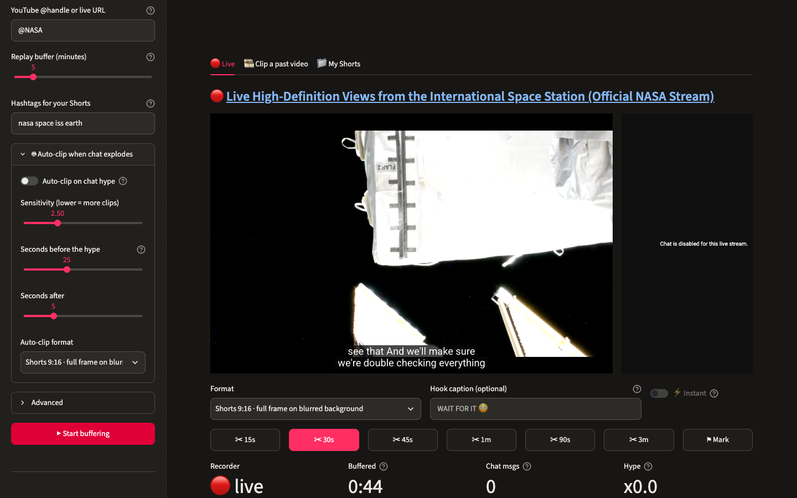
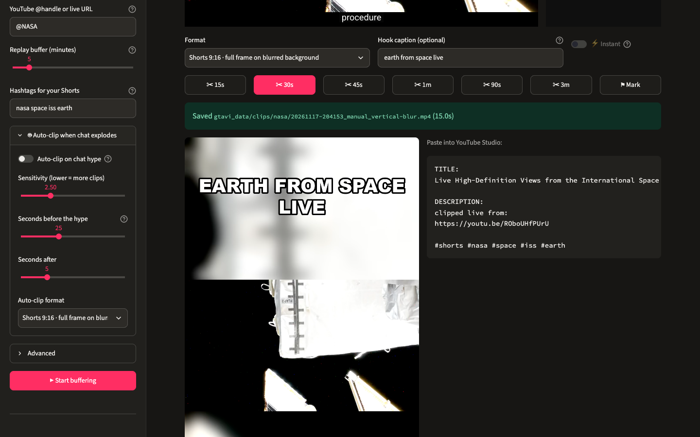
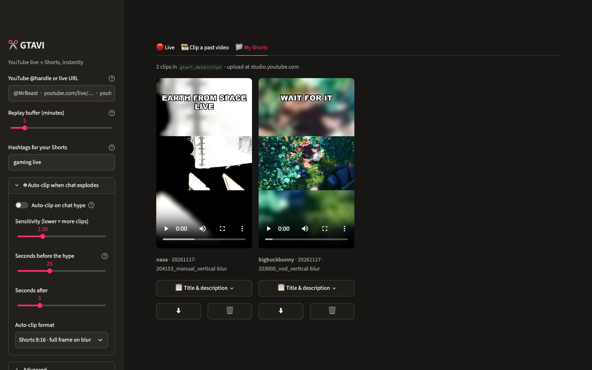

<div align="center">

# ✂️ Grab The Action, Viral Instantly (GTA VI)

**Turn YouTube live moments into Shorts, instantly.**

Watch any YouTube livestream. When something insane happens, hit one button and get the **last 30 seconds as a vertical 1080×1920 Short**, with a hook caption burned in and a ready-to-paste title, description and credit link.

Or let it watch chat for you: when live chat explodes with 😂💀🤯 / `NO WAY` / `CLIP IT`, GTAVI **clips it automatically**.

`Free` · `Open source` · `No API keys` · `No login` · `Runs on your machine`

<br>



<sub>☝️ Made with one command: <code>gtavi vod https://youtu.be/aqz-KE-bpKQ --start 6:38 --end 7:10 --caption "wait for it"</code></sub>

</div>

---

## Demo

### From stream to Short in one click



### The web app

Paste a YouTube `@handle`, hit **Start buffering**, and GTAVI finds the live stream, embeds the player and chat, and starts keeping a replay buffer. Here it's recording NASA's live ISS feed:



Hit **✂ 15s** and the Short is ready a few seconds later, along with its title, description and hashtags to paste into YouTube Studio:



Every clip collects in **My Shorts**, ready to download:



<sub>Demo footage: <a href="https://peach.blender.org/">Big Buck Bunny</a> © Blender Foundation, <a href="https://creativecommons.org/licenses/by/3.0/">CC BY 3.0</a>; ISS live views courtesy of NASA.</sub>

---

## Why

YouTube's own clip tool maxes out at 60 seconds, gives you a link instead of a file, and can't make Shorts. GTAVI keeps a **rolling replay buffer** of the stream on your disk, so you can clip something that happened **minutes ago** and walk away with an MP4 that's ready to upload as a Short.

Built for big launch-night streams where the best moments happen while you're watching a different channel.

## Features

| | |
|---|---|
| 🔴 **Rolling replay buffer** | Records the live stream to disk without re-encoding (near-zero CPU) and keeps only the last N minutes |
| 📱 **Shorts by default** | 1080×1920 vertical: full frame on a blurred background, or a center crop. Capped at YouTube's 3-minute Shorts limit |
| 🪝 **Hook captions** | Big bold "WAIT FOR IT" text burned onto the top of the Short |
| 📋 **Upload kit** | Every clip gets a `.txt` with a title, a description with a credit link back to the stream, and your hashtags |
| ✂️ **One-click clips** | Last 15s / 30s / 45s / 1m / 90s / 3m |
| 🤖 **Auto-clip on chat hype** | Reads YouTube live chat (no API key) and clips when message rate and hype emoji spike |
| ⚑ **Markers** | Tag a moment now, clip around it later while it's still in the buffer |
| 🎞 **Past-video clipper** | Grab `1:23:45 → 1:24:30` from any past livestream or video without downloading the whole thing |
| 🖥 **Web UI + CLI** | Streamlit app with the YouTube player and live chat embedded, or a terminal mode where you press Enter to clip |
| 📺 **Multi-stream** | Buffer several channels at once and clip whichever one pops off |
| 🌍 **Twitch & Kick too** | Paste `twitch.tv/name` or `kick.com/name` and everything works the same (Twitch chat hype included) |

## Quick start

You need **Python 3.10+**. ffmpeg and the JS runtime YouTube needs are installed automatically by pip.

```bash
git clone https://github.com/ashutosh8021/Grab-The-Action-Viral-Instantly-GTA-VI.git
cd Grab-The-Action-Viral-Instantly-GTA-VI
python3 -m venv .venv && source .venv/bin/activate   # Windows: .venv\Scripts\activate
pip install -e .
gtavi ui            # opens http://localhost:8501
```

Paste a channel (`@SomeStreamer`, `youtube.com/live/…`, `youtu.be/…`), press **Start buffering**, and clip away. GTAVI finds the channel's current livestream automatically. Clips land in `gtavi_data/clips/<channel>/`, each next to its upload kit `.txt`.

### Docker

```bash
docker build -t gtavi .
docker run -p 8501:8501 -v "$PWD/gtavi_data:/app/gtavi_data" gtavi
```

## Terminal mode

```bash
gtavi live @SomeStreamer                         # Enter = clip last 30s, m = mark, q = quit
gtavi live @SomeStreamer --auto --tags gta6 gaming
gtavi live @SomeStreamer --caption "WAIT FOR IT" --length 45 --buffer 600
gtavi vod "https://youtu.be/VIDEO_ID" --start 1:02:03 --end 1:02:45 --caption "he really did that"
gtavi live twitch.tv/somebody --format original   # 16:9 instead of Shorts
```

```
… looking up youtube:@SomeStreamer
  GTA 6 LAUNCH NIGHT - FIRST LOOK  (https://youtu.be/abc123xyz00)
▶ buffering youtube:@SomeStreamer (last 300s kept) + auto-clip on chat hype
  [Enter] clip last 30s   [m] mark   [c <secs>] custom length   [q] quit

  ✂  saved gtavi_data/clips/somestreamer/20261119-230114_hype-chat-x6-3-no-way_vertical-blur.mp4  [hype chat x6.3 (😂 no way 💀), 30.0s]
     shorts text: gtavi_data/clips/somestreamer/20261119-230114_hype-chat-x6-3-no-way_vertical-blur.txt
```

The upload kit looks like this:

```
TITLE:
GTA 6 LAUNCH NIGHT 😳 #shorts

DESCRIPTION:
Hype chat x6.3 (😂 no way 💀) - clipped live from:
https://youtu.be/abc123xyz00

#shorts #gta6 #gaming
```

## How it works

```
 YouTube live (@handle → current live video, via yt-dlp)
          │  streamlink pulls the HLS stream
          ▼
   ffmpeg -c copy -f segment          ← no re-encode, ~0% CPU
          │
          ▼
 gtavi_data/buffer/<channel>/seg_0000123.ts   (2s each, oldest deleted)
          │
   "clip last 30s" ──► pick segments ──► join ──► 9:16 + caption ──► short.mp4 + short.txt

 YouTube live chat (yt-dlp, no API key) ──► hype detector ──► auto "clip last 25s + next 5s"
```

**Hype detection:** each chat message gets a weight: 1, plus a bonus for hype words (`clip`, `no way`, `omg`, `wtf`, `insane`…) and emoji (😂 🤣 💀 🤯 😱 🔥…), capped so one spammer can't trigger it. If the weighted message rate over the last 8s is more than *sensitivity ×* the rate over the previous 90s, it's a hype moment. There's a 45s cooldown. YouTube chat arrives a few seconds late, which is why auto-clips grab 25s *before* the spike. Tune sensitivity in the sidebar or with `--sensitivity` (lower = more clips).

## Use it as a library

```python
from gtavi import ClipSession, parse_source

s = ClipSession(parse_source("@SomeStreamer"), buffer_seconds=600, auto_clip=True,
                tags=["gta6"], on_clip=lambda c: print("new short", c.path, c.kit))
s.start()
...
clip = s.clip_last(30, caption="wait for it").result()
s.stop()
```

## Tips

- **Disk:** the buffer at 1080p60 is roughly 6 MB per 10s, so a 5-minute buffer is about 200 MB. Use `--quality 720p` (or the Advanced box in the UI) to save space.
- **"isn't live right now":** GTAVI checks `youtube.com/@handle/live`. If the channel is live under a different video, paste that video's URL directly.
- **Captions:** emoji can't be drawn by normal fonts, so they're dropped from the burned-in caption but kept in the title. Set `GTAVI_FONT=/path/to/font.ttf` to use your own font.
- **Members-only / age-restricted streams:** pass cookies to yt-dlp/streamlink. See the [yt-dlp FAQ](https://github.com/yt-dlp/yt-dlp/wiki/FAQ#how-do-i-pass-cookies-to-yt-dlp).
- **YouTube changed something and it broke?** Run `pip install -U yt-dlp streamlink`. Both projects update within days.

## Development

```bash
pip install -e ".[dev]"
pytest -q            # includes an end-to-end test with a synthetic live stream
```

PRs welcome. Good first issues: direct upload to YouTube, auto-captions (Whisper), facecam-aware vertical layout, Discord webhook on new clip, a keyboard hotkey in the web UI.

## Responsible use

GTAVI is for highlights, commentary, and creators clipping **their own** streams. Respect streamers' wishes and YouTube's policies. Always credit the creator (the upload kit adds the link for you). GTAVI is a community project and is not affiliated with YouTube, Google, Twitch, Kick, or any game publisher.

## License

[MIT](LICENSE)
